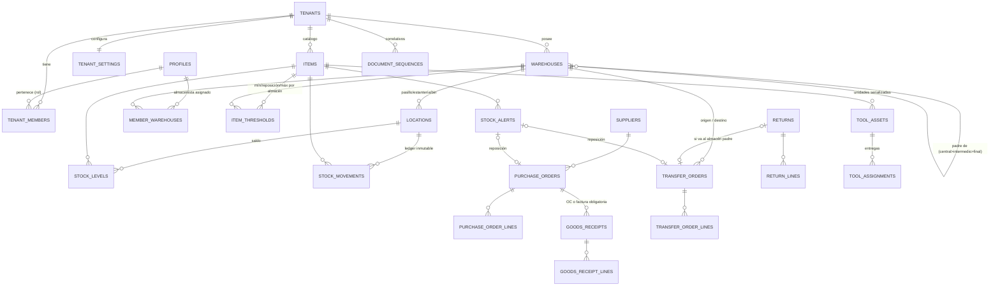
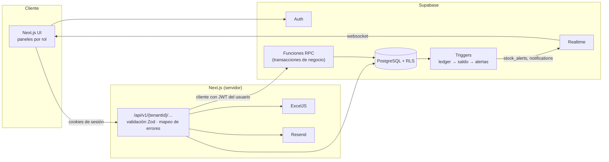
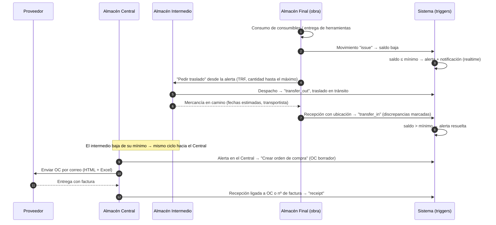
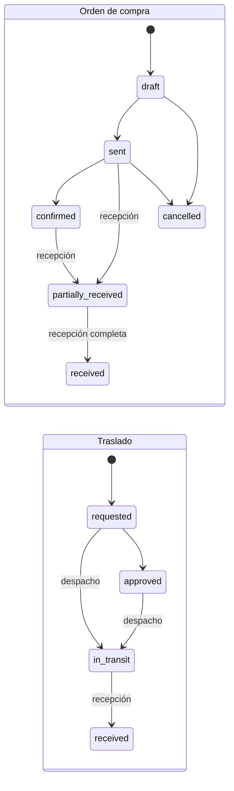

# Gutitool · Arquitectura

Gestión de inventario industrial **multitenant** con almacenes en tres niveles, control de consumibles y herramientas, compras, recepciones, traslados, devoluciones, alertas de stock mínimo, exportación a Excel y envío de pedidos por correo.

**Stack:** Next.js 15 (App Router, route handlers) · Supabase (PostgreSQL 15+, Auth, Realtime, RLS) · ExcelJS · Resend.

---

## 1. Esquema conceptual de la base de datos



### Decisiones clave

| Decisión | Por qué |
|---|---|
| **Base de datos compartida, `tenant_id` en cada tabla + RLS** | Un solo esquema que escala a miles de empresas; el aislamiento lo garantiza PostgreSQL, no el código. |
| **FKs compuestas `(tenant_id, id)`** | Es imposible, incluso por un bug, enlazar una línea de una empresa con un artículo o ubicación de otra. |
| **Roles en `tenant_members` (no en el JWT)** | Un usuario puede tener varios roles y varias empresas; revocar un rol tiene efecto inmediato sin esperar a que caduque el token. |
| **Ledger inmutable `stock_movements` + saldo `stock_levels` mantenido por trigger** | Trazabilidad total (kardex auditable). Los errores se corrigen con ajustes, nunca editando. El `UPDATE … WHERE qty + delta >= 0` bloquea la fila y evita stock negativo con operaciones concurrentes. |
| **Stock por ubicación** (`location_id, item_id`) | Cada artículo tiene ubicación exacta: Pasillo · Estantería · Bin (`P01-E03-B12`). |
| **Operaciones como funciones RPC transaccionales** | Recepción, traslado, devolución, consumo y entrega de herramientas son atómicos y validan rol + almacén en la propia BD. La API es una capa fina. |
| **Correlativos en tabla con bloqueo de fila** | `DEV-2026-000001`: únicos por empresa y año, **sin huecos** (si la transacción falla, el número no se consume) y no modificables. |
| **Herramientas = artículo `tool` + unidades `tool_assets`** | La cantidad se ve en el stock como cualquier artículo; cada unidad tiene nº de serie, estado y asignación abierta con fecha de devolución. |

### Tablas

| Bloque | Tablas |
|---|---|
| Multitenant y roles | `tenants`, `tenant_settings`, `profiles`, `tenant_members`, `member_warehouses` |
| Almacenes | `warehouses` (nivel `central` / `intermediate` / `final`, `parent_id`), `locations` |
| Catálogo | `items` (`consumable` / `tool`), `item_thresholds`, `suppliers` |
| Inventario | `stock_levels`, `stock_movements` |
| Compras | `purchase_orders`, `purchase_order_lines`, `goods_receipts`, `goods_receipt_lines` |
| Logística | `transfer_orders`, `transfer_order_lines` |
| Devoluciones | `returns`, `return_lines` |
| Herramientas | `tool_assets`, `tool_assignments` |
| Sistema | `stock_alerts`, `notifications`, `document_sequences`, `email_log` |

Vistas (respetan RLS con `security_invoker`): `v_stock_by_location`, `v_stock_network`, `v_order_tracking`, `v_movements_detail`, `v_tool_status`.

---

## 2. Roles y permisos

| Capacidad | Super Admin | Admin empresa | Supervisor | Auditor | Comprador | Transportista | Almacenista |
|---|:-:|:-:|:-:|:-:|:-:|:-:|:-:|
| Crear / suspender empresas | ✅ | | | | | | |
| Usuarios y roles de su empresa | ✅ | ✅ | | | | | |
| Almacenes, ubicaciones, umbrales | | ✅ | ✅ | | | | |
| Catálogo y proveedores | | ✅ | ✅ | | ✅ | | |
| Órdenes de compra, envío por correo | | ✅ | ✅ | | ✅ | | |
| Recepciones, consumos, devoluciones, herramientas | | ✅ todos | ✅ todos | | | | ✅ sus almacenes |
| Despachar / recibir traslados | | ✅ | ✅ | | | | ✅ origen / destino |
| Fechas estimadas de traslados | | ✅ | ✅ | | | ✅ los suyos | ✅ origen |
| Ajustes de inventario | | ✅ | ✅ | | | | |
| Ver todo el inventario de la empresa | | ✅ | ✅ | ✅ | ✅ | ✅ | ✅ |
| Exportar a Excel | | ✅ | ✅ | ✅ | ✅ | ✅ | ✅ |

Una empresa **suspendida** pierde el acceso al instante: todas las políticas exigen `tenants.status = 'active'`.

---

## 3. Arquitectura lógica



- La API usa **siempre el cliente con la sesión del usuario**: el RLS y las RPC aplican permisos. La clave secreta solo se usa para crear empresas e invitar usuarios, después de verificar el rol.
- El panel del Almacén Central se suscribe por **Realtime** a `stock_levels` y `stock_alerts`: ve el stock exacto de intermedios y finales sin recargar.

---

## 4. Flujo entre almacenes y alertas de stock

### 4.1 Ciclo completo



### 4.2 Reglas del motor de alertas

1. Se evalúa en **cada cambio de saldo** (`stock_levels`) y de umbral (`item_thresholds`), dentro de la misma transacción: no hay tareas programadas que puedan fallar.
2. Compara la suma del artículo **en el almacén** (todas sus ubicaciones) con `min_qty`.
3. Solo existe **una alerta activa** por artículo y almacén (índice único parcial): no se generan avisos repetidos.
4. Al crear la alerta se notifica a administradores, supervisores, compradores y a los almacenistas de ese almacén (tabla `notifications`, emitida por Realtime).
5. **Reposición en cascada:** una alerta en un almacén final o intermedio genera una **solicitud de traslado desde su almacén padre**; solo una alerta del **Central** genera una **orden de compra**. Así la compra se concentra en un único punto.
6. Cantidad propuesta: hasta `max_qty` si está definido; si no, `reorder_qty`.
7. La alerta pasa a `in_replenishment` con el documento vinculado (y sus fechas estimadas) y se resuelve sola cuando el saldo supera el mínimo.

### 4.3 Estados de los documentos



---

## 5. API REST (`/api/v1`)

Autenticación por sesión de Supabase (cookies). Todas las rutas de negocio van bajo `/{tenantId}`. Errores: `400` validación, `401` sin sesión, `403` sin permiso / empresa suspendida, `404`, `409` stock insuficiente o duplicado, `422` regla de negocio.

### Plataforma (Super Admin)
| Método | Ruta | Descripción |
|---|---|---|
| GET | `/admin/tenants` | Empresas con nº de usuarios |
| POST | `/admin/tenants` | Crea empresa + almacén central + invita al administrador |
| PATCH | `/admin/tenants/{id}` | Suspender / reactivar / editar |

### Empresa
| Método | Ruta | Descripción |
|---|---|---|
| GET / POST / DELETE | `/{tenantId}/members` | Usuarios, invitación y asignación de roles y almacenes |

### Inventario
| Método | Ruta | Descripción |
|---|---|---|
| GET | `/{tenantId}/stock` | Stock por ubicación (filtros: almacén, artículo, tipo, búsqueda) |
| GET | `/{tenantId}/stock/network` | **Visión del Central**: artículo × almacén con stock, tránsito, pedido y mínimo |
| GET | `/{tenantId}/movements` | Kardex paginado |
| POST | `/{tenantId}/movements` | `{type:"issue"}` consumo · `{type:"adjustment"}` ajuste |
| GET / POST | `/{tenantId}/tools` | Estado de herramientas · `checkout` / `checkin` |
| GET | `/{tenantId}/alerts` | Alertas activas con documento de reposición |
| POST | `/{tenantId}/alerts/{id}/replenish` | Genera OC (central) o traslado (resto) |

### Compras y recepción
| Método | Ruta | Descripción |
|---|---|---|
| GET / POST | `/{tenantId}/purchase-orders` | Listado (filtro `late=true`) · alta en borrador |
| GET / PATCH | `/{tenantId}/purchase-orders/{id}` | Detalle · estado y fechas estimadas |
| GET | `/{tenantId}/purchase-orders/{id}/export` | **Excel** del pedido |
| POST | `/{tenantId}/purchase-orders/{id}/email` | **Envío rápido** por correo (HTML + Excel adjunto) |
| GET / POST | `/{tenantId}/receipts` | Recepción ligada a **OC o nº de factura** (obligatorio) |

### Logística y devoluciones
| Método | Ruta | Descripción |
|---|---|---|
| GET / POST | `/{tenantId}/transfers` | Listado (`carrier=me` para transportistas) · solicitud |
| POST | `/{tenantId}/transfers/{id}/approve` · `/dispatch` · `/receive` · `/eta` | Ciclo del traslado |
| GET / POST | `/{tenantId}/returns` | Devoluciones con correlativo `DEV-AAAA-NNNNNN` |
| POST | `/{tenantId}/returns/{id}/post` | Contabiliza una devolución en borrador |
| GET | `/{tenantId}/tracking` | Cada ítem en curso con **fecha estimada de despacho y entrega** y retraso |

### Exportaciones
| Método | Ruta | Descripción |
|---|---|---|
| GET | `/{tenantId}/exports/stock.xlsx` | Stock por ubicación + red de almacenes |
| GET | `/{tenantId}/exports/movements.xlsx?from=&to=` | Movimientos |
| GET | `/{tenantId}/exports/orders.xlsx` | OC y traslados con fechas estimadas |

### Ejemplos

```http
POST /api/v1/{tenantId}/receipts
{
  "warehouseId": "…",
  "purchaseOrderId": "…",
  "lines": [{ "itemId": "…", "locationId": "…", "quantity": 400 }]
}
→ 201 { "id": "…", "number": "REC-2026-000001" }
```

```http
POST /api/v1/{tenantId}/returns
{
  "warehouseId": "…", "kind": "to_supplier", "supplierId": "…",
  "reason": "Lote defectuoso",
  "lines": [{ "itemId": "…", "locationId": "…", "quantity": 20 }]
}
→ 201 { "id": "…", "number": "DEV-2026-000002" }
```

```http
GET /api/v1/{tenantId}/stock/network?belowMin=true
→ { "data": [{ "sku": "EPI-GNT-09", "total_on_hand": 313,
      "warehouses": [{ "code": "OBRA-1", "level": "final", "qty_on_hand": 13, "min_qty": 20, "below_min": true }, …] }] }
```

---

## 6. Hoja de ruta sugerida

1. **UI por rol**: panel del Central (matriz de red en tiempo real), terminal de almacenista optimizada para móvil/escáner, bandeja del comprador, vista del transportista.
2. **Códigos de barras / QR** en ubicaciones y herramientas (el `code` de ubicación ya es un identificador estable).
3. **Inventario cíclico** con conteos ciegos que generan ajustes aprobados por supervisor.
4. **Resumen diario por correo** de alertas y entregas retrasadas (`pg_cron` + Edge Function).
5. **Coste medio ponderado** en recepciones para valoración contable.
6. Tipos TypeScript generados (`npm run db:types`) y tests de API.
